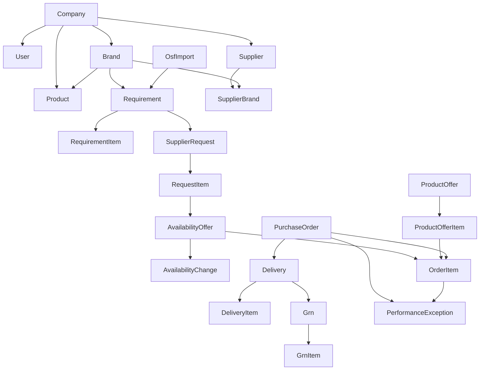

# Database design (Stage 2A proposal, revised)

This document proposes the Phase 1 data model. The Prisma schema in `prisma/schema.prisma` matches this design. **No database is connected. No migrations have been applied.**

## Locked Phase 1 decisions

- **Purchasing tenancy:** One purchasing company. Many supplier companies. No multi-purchasing-company tenancy.
- **Supplier users:** Multiple `User` rows may belong to one `Supplier`. MVP UI may still behave as one primary user. Every supplier-facing query filters by session `supplierId`.
- **Workflows preserved:** OSF → draft requirement → staff confirm → supplier requests → availability → allocate/order → confirm → partial deliveries → verify → immutable GRN; plus supplier product offers.

## Significant revision summary

Prior review findings 1–10 remain. **Final Stage 2A corrections:**

| Issue | Change |
| --- | --- |
| Partial delivery then cancel | `OrderItem` tracks `quantityOrdered`, `quantityCancelled`, `quantityVerifiedReceived` + statuses `PARTIALLY_CANCELLED` / `FULFILLED`. Cancel only undelivered qty; preserve GRN; return only cancelled qty to outstanding. |
| PerformanceException | `affectedQuantity`, preserved `originalExpectedDeliveryAt`, `adjustmentValue` + `adjustmentUnit` (`PENALTY_POINTS`), review status/notes. |
| Ownership FKs | Composite unique + composite FKs bind child `supplierId`/`companyId` to parents where practical. |
| Provisional products | `Product.masterStatus` `PROVISIONAL` \| `ERP_LINKED`; offer→order creates provisional portal products only — not ERP masters. |

---

## 1. Availability accounting (exact semantics)

### Fields on `AvailabilityOffer`

| Field | Meaning |
| --- | --- |
| `quantityDeclared` | Supplier’s **latest** declared available quantity. Staff never write this. May be lowered below `quantityOrderedActive` (warning, not hard block). |
| `quantityOrderedActive` | Denormalized **sum** of `(quantityOrdered - quantityCancelled)` for linked `OrderItem`s. Updated only inside allocate/cancel transactions. Verified/received qty stays in this remainder until the undelivered portion is cancelled. |
| `reservedAt` / `reserveExpiresAt` | Set when positive availability is submitted. Partial orders **must not** change `reserveExpiresAt`. |
| `status` | `DRAFT`, `SUBMITTED`, `NOT_AVAILABLE`, `CANCELLED`, `EXPIRED`. |

### What was removed and why

Offer-level `quantityCancelled` was removed earlier to avoid double-counting with order-line releases. Cancellation is expressed on **order lines** and/or by withdrawing remaining **reserve** on the offer.

### Remaining allocatable (new allocations only)

While `status = SUBMITTED`, reserve not expired, and allocating quantity `n`:

```text
quantityOrderedActive + n <= quantityDeclared
reserveExpiresAt > now()
```

Enforced with a **conditional UPDATE** / row lock — **not** a CHECK that blocks `quantityDeclared < quantityOrderedActive`.

### Supplier decrease below ordered

- Allowed.
- Write `AvailabilityChange` with `WARNING_BELOW_ORDERED` / `warningBelowOrdered = true`.
- Notify company staff.
- Do **not** auto-reduce order quantities.

### Partial delivery then cancellation (explicit)

Example: order line ordered **100**; **40** verified with GRN issued; cancel remaining **60**.

| Field / artifact | After cancel |
| --- | --- |
| `quantityOrdered` | 100 (unchanged) |
| `quantityVerifiedReceived` | 40 (unchanged; GRN untouched) |
| `quantityCancelled` | 60 |
| `status` | `PARTIALLY_CANCELLED` |
| `AvailabilityOffer.quantityOrderedActive` | decreased by **60** only |
| Outstanding demand | increased by **60** only |
| New `AvailabilityOffer` | **not** auto-created |

**Invariants (transaction-enforced):**

```text
quantityCancelled >= 0
quantityVerifiedReceived >= 0
quantityCancelled + quantityVerifiedReceived <= quantityOrdered

cancellableNow =
  quantityOrdered
  - quantityVerifiedReceived
  - quantityCancelled
  - sum(SUBMITTED DeliveryItem qty for this line)
```

**Safe cancel transaction for quantity `n`:**

1. Lock `OrderItem` (+ parent `PurchaseOrder.version` / offer row).
2. If `n > cancellableNow` because of SUBMITTED holds: either reject the cancel, or in the **same** transaction set those SUBMITTED deliveries to `REJECTED` (freeing hold), then cancel. Never cancel qty that remains SUBMITTED without resolving the delivery.
3. Increment `quantityCancelled` by `n`; set status `PARTIALLY_CANCELLED` or `CANCELLED` (only if verified=0 and cancelled=ordered).
4. Decrease `AvailabilityOffer.quantityOrderedActive` by `n`; append `AvailabilityChange` (`ORDER_ALLOCATION_RELEASED`).
5. Do **not** modify `Grn` / `GrnItem` / verified delivery rows.
6. Notify staff; audit; idempotency key for the cancel request.
7. Outstanding (recomputable):

```text
outstanding = quantityPlanned
            - sum(quantityOrdered - quantityCancelled)
              over OrderItems linked via RequirementItem → RequestItem → AvailabilityOffer
```

For the example with planned 100: outstanding = 100 - (100 - 60) = **60**.

Cancelled qty may be covered by a **new** `SupplierRequest`. Do not auto-create availability.

### Full-line cancel (no receipts)

`quantityVerifiedReceived = 0`, `quantityCancelled = quantityOrdered`, status `CANCELLED`. Same release rules; still no auto availability.

### Reserve expiry

- Expiry sets offer `EXPIRED` (job/transaction); does not fabricate availability elsewhere.
- Remaining unallocated declared qty is no longer allocatable after expiry.

---

## 2. Schema vs application: decrease-below-ordered

| Rule | Where enforced |
| --- | --- |
| Non-negative quantities on write | Application + optional SQL CHECK `>= 0` in Stage 2B migrations |
| `quantityOrderedActive <= quantityDeclared` | **Must NOT** be a database CHECK |
| Warning when declared < ordered | Application + `AvailabilityChange` |
| Staff cannot create/inflate offers | Application authorization |

---

## 3. Supplier / company ownership consistency

### Ownership chain

```text
SupplierRequest.(supplierId, companyId)
  → RequestItem.(supplierId, companyId)     composite FK to request
    → AvailabilityOffer.supplierId          composite FK to request item
      → OrderItem.(supplierId, companyId)   composite FK to PO (+ offer when present)
PurchaseOrder.(supplierId, companyId)       composite FK to Supplier
Delivery.(supplierId, companyId)            composite FK to PO
ProductOffer.(supplierId, companyId)
  → ProductOfferItem.(supplierId, companyId)
User.(supplierId, companyId)                optional composite FK to Supplier
```

### Schema-enforced (composite unique + composite FK)

Where practical, parents expose `@@unique([id, supplierId])`, `@@unique([id, companyId])`, and/or `@@unique([id, supplierId, companyId])`. Children reference those composites so a row cannot point at a parent id while carrying a **different** `supplierId` / `companyId`.

Optional relations (`availabilityOfferId`, `productOfferItemId`, `productOfferId`) use composites when set; when the optional id is null, the relation is absent (Prisma multi-field optional FK behavior).

### Still application-enforced

| Concern | Why app still needed |
| --- | --- |
| Caller authorization | Session `user.supplierId` / staff permissions — not in FK |
| Client body ownership ids | **Ignore.** Set from session or staff selection server-side |
| Cross-aggregate rules | e.g. all lines on a PO share one supplier (also aided by composites) |
| Role ↔ `User.supplierId` nullability | `SUPPLIER` requires supplier; ADMIN/STAFF require null |
| Writing the denormalized ids | Server copies from parent; never from client |

Never trust client-provided `supplierId` or `companyId`.

---

## 4. Product–Brand and “All Brands”

| Model | Role |
| --- | --- |
| `Brand` | Company brand catalog. |
| `Product.brandId` | Every product belongs to a brand (brand-specific OSF lines). |
| `Requirement.brandId` | Requirement is brand-scoped for matching and distribution. |
| `SupplierBrand` | Explicit brand membership. |
| `Supplier.supportsAllBrands` | Registration option **All Brands**: supplier matches every brand for request distribution. |

### Matching (application)

A supplier is eligible for a requirement/request of brand `B` when:

- `supportsAllBrands = true`, **or**
- a `SupplierBrand` row exists for `(supplierId, B)`.

### Active-request brand removal (application)

Do not delete `SupplierBrand` for brand `B` while the supplier has a `SupplierRequest` for `B` in an active status (`NEW`, `PARTIALLY_RESPONDED`, `RESPONDED` — finalize “active” set in Stage 2B).

Turning off `supportsAllBrands` is blocked (or requires review) while any active request exists for brands not covered by remaining `SupplierBrand` rows — exact UX unresolved; data model supports the check.

Schema uses `onDelete: Restrict` on `SupplierBrand` so brand/supplier deletes do not silently wipe membership.

---

## 5. Delivery quantity invariants

Open ordered capacity on a line:

```text
openOrdered = quantityOrdered - quantityCancelled
```

```text
sum(SUBMITTED DeliveryItem qty) + quantityVerifiedReceived <= openOrdered
```

| Delivery status | Counts toward cap? | Counts as received? |
| --- | --- | --- |
| `SUBMITTED` | Yes (hold) | No |
| `VERIFIED` | Yes (via `quantityVerifiedReceived`) | Yes |
| `REJECTED` | No | No |

On verify: increment `quantityVerifiedReceived`; issue immutable GRN; never decrease verified later for cancellation (cancel only undelivered remainder).

### Concurrency and retries

- Lock `OrderItem` / `PurchaseOrder` in the delivery transaction.
- `Delivery.idempotencyKey` unique per `purchaseOrderId`.
- `@@unique([deliveryId, orderItemId])` per delivery.

### Cancel vs submitted-unverified

Cannot cancel into qty still held by `SUBMITTED` deliveries. Same transaction must `REJECT` those deliveries (or abort). Then cancel the freed remainder. Verified qty and GRNs stay.

---

## 6. Product offers, provisional products, and order traceability

### `Product.masterStatus`

| Status | Meaning |
| --- | --- |
| `PROVISIONAL` | Portal-internal product. `erpItemId` must be null. Created when converting a **new** offer line. |
| `ERP_LINKED` | Linked to an existing ERP item (`erpItemId` set) via OSF/import or a later sync job — **not** by offer→order alone. |

`ProductOfferItem.proposedErpItemId` is a **suggested code only**. Converting an offer to an order must **not** create an ERP master item or set `masterStatus = ERP_LINKED`.

### Convert offer → order

1. Existing line: use `productId` (provisional or ERP-linked).
2. New product line: create `Product` with `masterStatus = PROVISIONAL`, name/sku/brand from proposed fields; leave `erpItemId` null.
3. `PurchaseOrder.productOfferId` + each `OrderItem.productOfferItemId` + `productId` for traceability.
4. Later ERP sync (Phase 2 or a dedicated job) may set `erpItemId` and `ERP_LINKED` — out of Stage 2A runtime scope.

---

## 7. Performance exceptions (lightweight)

| Type | Required fields (app) | Adjustment |
| --- | --- | --- |
| `COMPANY_CAUSED_DELAY` | `affectedQuantity`, `originalExpectedDeliveryAt` (snapshot; do not overwrite `OrderItem.originalExpectedDeliveryAt`) | — |
| `CANCELLATION_PENALTY_REDUCTION` | `adjustmentValue`, `adjustmentUnit = PENALTY_POINTS` | Applied to scoring only when `status = APPROVED` |

Review: `PENDING` → `APPROVED` / `REJECTED` with `reviewedById`, `reviewedAt`, optional `reviewNotes`.

Links optional `purchaseOrderId` / `orderItemId`. No analytics warehouse in Phase 1.

---

## 8. GRN immutability and correction strategy

- `Grn` has **no** `updatedAt`.
- `onDelete: Restrict` from delivery and to items.
- Application: **no UPDATE, no DELETE** APIs for issued GRNs.
- `erpDocumentId` may be set once when manually posted to ERP (unresolved whether that single write is allowed after issue — treat as unresolved; prefer writing at issue time or a separate non-mutating integration log later).

**Correction strategy (Phase 1 stance):** do not silently edit. If a wrong GRN must be fixed after business approval of a process, create a **new compensating document** in a later schema revision — not an in-place change. No correction table in this proposal until that process is decided.

---

## 9. `onDelete` policy

| Relation class | Policy |
| --- | --- |
| Business records (requirements, requests, offers, orders, deliveries, GRN, changes, audit) | `Restrict` |
| `StaffPermission` → `User` | `Cascade` (grants only) |
| `Notification` → `User` | `Cascade` (inbox only) |

This avoids wiping confirmed orders, deliveries, availability history, or issued GRNs via parent deletes.

---

## 10. Invariants, uniqueness, nullability

### Schema-enforced

- Unique / composite unique as in schema (including parent `(id, supplierId[, companyId])` for composite FKs)
- Composite FKs binding child ownership ids to parents
- `AvailabilityOffer.requestItemId` unique; delivery/GRN uniques; idempotency uniques
- Restrict deletes on business/history relations

### Application / transaction-enforced

- Authorization and ignoring client ownership ids
- Role ↔ `User.supplierId` nullability
- Availability allocate conditional update; declared may be below ordered (warning)
- Partial cancel math; SUBMITTED delivery handling before cancel
- Outstanding after cancel; re-request without auto availability
- Delivery caps vs `openOrdered`; verify → GRN insert-only
- `PROVISIONAL` products: no ERP master on offer convert; `erpItemId` null until `ERP_LINKED`
- Performance exception field requirements by type; scoring uses APPROVED only
- Brand removal / All Brands vs active requests
- Whole-order supplier confirmation; idempotency; staff permissions

### Notable nullable fields

- `Product.erpItemId` null when `PROVISIONAL`
- `AvailabilityOffer.unitPrice` / dates when draft / not available
- `OrderItem.availabilityOfferId` / `productOfferItemId` depending on path
- `ProductOfferItem.productId` until materialized
- `PerformanceException.affectedQuantity` / adjustment fields by type
- `Delivery.idempotencyKey` prefer always set

---

## Entity overview



## Models (concise)

| Area | Models |
| --- | --- |
| Identity | `Company`, `User`, `StaffPermission`, `Supplier`, `Brand`, `SupplierBrand` |
| Catalog | `Product` (branded reference data; not Phase 2 catalog mgmt) |
| Demand | `OsfImport`, `Requirement`, `RequirementItem` |
| Supply response | `SupplierRequest`, `RequestItem`, `AvailabilityOffer`, `AvailabilityChange` |
| Fulfillment | `PurchaseOrder`, `OrderItem`, `Delivery`, `DeliveryItem`, `Grn`, `GrnItem` |
| Offers | `ProductOffer`, `ProductOfferItem` |
| Scoring support | `PerformanceException` |
| Cross-cutting | `Notification`, `AuditLog`, `IdempotencyKey` |

## Transaction boundaries (updated)

1. OSF import (idempotent) → requirement + items  
2. Confirm requirement  
3. Create supplier requests (match All Brands / SupplierBrand)  
4. Autosave/submit availability (supplier session scope; set reserve timestamps)  
5. Decrease declared qty (allow below ordered + warning change + notify)  
6. Allocate/create order (conditional update on offer; sync `quantityOrderedActive`)  
7. Supplier confirm whole order  
8. Partial/full cancel (reject SUBMITTED holds if needed; bump `quantityCancelled` only; preserve verified/GRN; release offer active qty by cancelled amount; **no** auto availability)  
9. Submit delivery (cap vs `openOrdered`; idempotency)  
10. Verify delivery + issue GRN (bump `quantityVerifiedReceived`; insert-only GRN)  
11. Product offer → order (provisional `Product` for new items; `productOfferItemId` trace)  
12. Performance exception request/approve (delay qty or penalty-point adjustment)  

## Unresolved business decisions

| Topic | Notes |
| --- | --- |
| Final staff permission catalog | Enum is provisional |
| Exact “active request” statuses for brand-removal blocking | Proposed set above; confirm |
| Self-registration activation | `PENDING_REVIEW` vs `ACTIVE` |
| Reserve/offer window clock | 7×24h vs calendar; timezone |
| Order above planned qty accounting | Structurally allowed |
| Repeated cancellation threshold / manual handling | Countable from cancelled orders/changes |
| Whether `Grn.erpDocumentId` may be patched after issue | Prefer avoid; unresolved |
| Full GRN compensating-document process | Not modeled until decided |
| Notification channels | In-app first |
| Currency / tax / UOM / decimal scale | Provisional decimals |
| Auth library / sessions | `User` only |
| Cosmo OS / OSF / ERP field contracts | Opaque `payload` / external ids only |
| Who may request vs approve performance exceptions | Permission codes provisional |
| Max cancellation penalty points and formula | Scoring module later; store `adjustmentValue` only |
| Process/timing to promote `PROVISIONAL` → `ERP_LINKED` | Out of Stage 2A |
| Whether cancel auto-rejects SUBMITTED deliveries or requires explicit staff step | Data model supports either; confirm UX |

## Stage boundary

| In Stage 2A | Not in Stage 2A |
| --- | --- |
| This document + `prisma/schema.prisma` | Neon, migrate, db push, seed |
| Non-destructive validate / lint / typecheck | App Prisma Client, auth, APIs |

Stop after review approval before Stage 2B.
